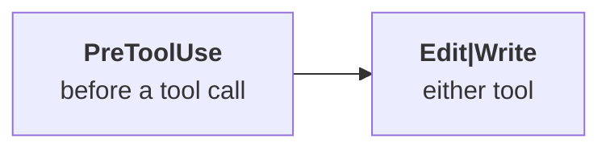

## Differences from CommonMark

| Area | Plain CommonMark | Here |
| --- | --- | --- |
| Attribute lists | none | a trailing `<!-- {: … } -->` applies to the block above |
| Tables | GFM tables only | extra `| --- |` rows split `<tbody>`; short rows padded with `&nbsp;` |
| Table alignment | GFM's `:---` markers | markers are ignored; use `.-left-align` |
| Code | indented code allowed | fences only, enforced by CI |
| Headerless tables | GFM rejects them | rejected by CI too |
| Jekyll tags | literal text | `raw` pairs strip; `common/` includes inline |
| Headings | no ids | slugs are added as `id` attributes |
| GFM extras | none | strikethrough, bare-URL autolinks |

## Sections

An H2 starts a section; an H3 is a card inside it. Both get an id from their text.

- Layout classes go on the H2: `.-three-column`, `.-one-column`, `.-left-reference`, `.-snippets` (`.-two-column` is the default).
- `.-prime` highlights a single H3, once per sheet at most.
- `.-full-width` on an H3 spans every column of its H2 section, for a wide table followed by narrower cards.
- Sheets with `layout: snippet` put `.-snippet` on every H3, omit "cheatsheet" from the H1, and end with a Related links card; see [snippet layout](writing-guidelines.md#snippet-layout).
- The first card is the Introduction, generated from `intro` and `links` frontmatter.

````md
## Queries
<!-- {: .-three-column} -->

### Basic query

```js
{ status }
```
````

## Attribute lists

An HTML comment holds the attributes for the block directly above it. It works on
headings, paragraphs, lists, tables and code fences, and blank lines in between
are fine.

````md
### Setting default props
<!-- {: .-prime} -->

| Option | Description |
| --- | --- |
| `a` | First |
<!-- {: .-key-values} -->
````

- Classes are `.name`; join them as `.a.b` or `.a .b`.
- Other attributes are `key="value"` (`key='value'` and bare values work too).
- Unrecognised tokens are ignored.
- A comment with no parsable attributes, or with no block above it, is left in
  place as an ordinary comment.
- Prefer one attribute comment per block.

## Code

Use fenced code blocks; indented code is rejected by CI.

- Put the language on the fence: ` ```ruby `.
- Put an attribute comment after the closing fence: `.-setup` mutes the block, `data-highlight="save_screenshot"` tints matching text, `.-wrap` wraps long lines, `.-box-chars` tightens box drawing.
- Keep code lines at 70 characters or less (42 inside `.-three-column`).

````md
```ruby
puts "hi"
```
<!-- {: .-setup data-highlight="puts"} -->
````

`data-highlight` takes a semicolon-separated list of literal strings and tints the first occurrence of each token inside the block. Matches stop at identifier boundaries, so `-d` does not match inside `--diff-context`. Use it to point at one API name without shading its whole line.

A `mermaid` fence renders as a diagram instead of highlighted code. Diagrams fit the card and zoom on hover, focus, or tap. Mermaid is not a Prism language; these fences bypass highlighting.

- Name the diagram with `accTitle:` and describe it with `accDescr:` inside the source.
- Don't put a `title="..."` on the fence; CI rejects it.
- Bold each node's label and add a short description after `<br>`.

````md

````

## Tables

Tables use kramdown's dialect, not GFM's.

- A header row plus a `| --- |` separator row is required; headerless tables are rejected by CI.
- Extra `| --- |` rows split the table into more `<tbody>` sections.
- Short rows are padded out to the widest row with `&nbsp;`.
- Alignment markers (`:---`, `:---:`, `---:`) are accepted but ignored.
- Classes: `.-shortcuts` / `.-shortcuts-right` (key columns), `.-key-values`, `.-css-breakdown`, `.-left-align`, `.-headers`, `.-no-wrap`.

````md
| Command | Description |
| --- | --- |
| `pnpm dev` | Dev server |
| --- | --- |
| `pnpm build` | Production build |
````

| Command | Description |
| --- | --- |
| `pnpm dev` | Dev server |
| --- | --- |
| `pnpm build` | Production build |

## Lists

- Tight and loose lists follow CommonMark; a blank line between items makes the list loose and wraps items in `<p>`.
- Don't indent wrapped item text; continuation lines start at column 0.
- `.-also-see` lays a link list out as a row; `.-six-column` and `.-four-column` lay items out in columns.
- `.-term-tiles` lays items out as bordered cards in a two-column grid; an odd last item spans both columns. Each bold term sits above its description with no bullet, and descriptions may contain inline code.

````md
* [Alpha](/alpha)
* [Beta](/beta)
<!-- {: .-also-see} -->
````

- `.-enum` lays short values out as a 2- or 4-tile grid; `.-enum-wide` caps at 2 columns for longer values.
- `.-enum-lines` replaces tiles with horizontal rules between rows; the final rule is clipped.
- All three drop bullet dots; items wrap instead of clipping.
- `.-enum` and `.-enum-lines` expect items of 13 characters or fewer; `.-enum-wide` expects at least one item of 14 or more.

````md
- `ios`
- `android`
- `web`
<!-- {: .-enum} -->
````

## Jekyll tags

Liquid is gone, but two legacy tags still expand:

- a `raw` / `endraw` pair strips itself;
- an include tag with a `common/<file>.md` path inlines `_includes/common/<file>.md`, substituting the tag's `title` into the file's `include.title` placeholder.

They can't be shown here, since writing them literally expands them. Everything else (`if`, `{{ … }}`) stays literal text.

## Not supported

- `{::options … /}` — renders as literal text.
- Indented code blocks and headerless tables — rejected by CI.
- Alignment markers (`:---`) — ignored; see [Tables](#tables).
- `=` (tfoot) and `+` separator rows — no longer special; they become ordinary rows.
- Inline attributes (`* {:.cls} item`) — not applied; use an attribute comment.
- Comments placed before a block — they attach to the block above, never the one below.
- Tables inside blockquotes or lists — fall back to GFM's table HTML.
