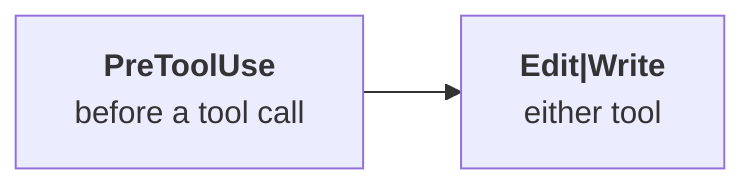

# Cheatsheet rules

## Rules

Each rule has a stable slug that reviewers and the sheet skill link to. General authoring guidance is in [writing guidelines](writing-guidelines.md).

### tables/cli-options

🤖 Check: `tables/shortcut-keys`.

CLI flags and slash commands get a plain table. `.-shortcuts` is for keypress columns only.

````md
| Flag                   | Description                      |
| ---------------------- | -------------------------------- |
| `-p, --print`          | Print the response and exit      |
| `--output-format json` | `text`, `json`, or `stream-json` |
| `--bare`               | Skip hooks, plugins, and memory  |
````

### tables/command-first

🤖 Check: `tables/command-first`.

In a table where a row has a cell made only of backticked code, put that code in the first column and its description after it. Commands, flags, values and paths all count.

Code mentioned inside a description does not count as a code column.

````md
| Command | Situation |
| --- | --- |
| `/grill-me` | Idea is fuzzy, no repo |
````

Do not put the command in a later column:

````md
| Situation | Command |
| --- | --- |
| Idea is fuzzy, no repo | `/grill-me` |
````

### tables/shortcut-keys

🤖 Check: `tables/shortcut-keys`.

Keypress columns get `.-shortcuts`. Use `.-shortcuts-right` when the key column is last.

````md
| Shortcut | Description   |
| -------- | ------------- |
| `Ctrl+C` | Interrupt     |
| `Esc`    | Close dialogs |

<!-- {: .-shortcuts} -->
````

### code/wrap-long-lines

🤖 Check: `code/wrap-long-lines`.

Code lines stay under 70 characters (42 in `.-three-column` sections). Wrap onto more lines rather than exceed the limit; add `.-wrap` when a line still overflows, and break arrow bodies as `=> (` … `)`. Wrapping is never a reason to avoid `.-three-column`.

````js
const fraction = (options) => (
  options.numerator / options.denominator
)
````

### code/mermaid-fences

🤖 Check: `code/mermaid-fences`.

Use a `mermaid` fence for diagrams. Name it with `accTitle:` and describe it with `accDescr:` inside the source; don't put a `title="..."` on the fence. Bold each node label and add a short description after `<br>`.

````md

````

### code/highlight-the-message

Every `data-highlight` token must illustrate the card's main message. Tint the flag or value that carries the point; leave secondary options and edge cases to the prose.

**Anchor on the keyword the card is named after.** Start with the clause or command that gives the card its title: `WHERE` on "Filter rows", `ORDER BY` and `LIMIT` on "Sort and limit", `CREATE TABLE` on "Create table". A narrower option such as `DISTINCT`, `OFFSET`, or `PRIMARY KEY` is a bad default; tint it only when that option is the card's subject.

**Good:** the card is about creating a table, so the command is tinted.

````md
### Create table

```sql
CREATE TABLE accounts (id INTEGER PRIMARY KEY);
```
<!-- {: data-highlight="CREATE TABLE"} -->
````

**Bad:** the card is about creating a table, but the tint lands on a constraint detail.

````md
### Create table

```sql
CREATE TABLE accounts (id INTEGER PRIMARY KEY);
```
<!-- {: data-highlight="PRIMARY KEY"} -->
````

**Good:** the card is about printing a range, so the range flag is tinted.

````md
### Print a range

```bash
bat -r 2:4 hello.py
```
<!-- {: data-highlight="-r 2:4"} -->
````

**Bad:** the card is about Git changes, but the tint lands on a context option instead of `-d`.

````md
### Show Git changes

```bash
bat -d notes.txt
bat -d --diff-context=1 notes.txt
```
<!-- {: data-highlight="--diff-context=1"} -->
````

### code/highlight-the-token

🤖 Check: `code/data-highlight-in-block`.

Give every code block whose subject is named in its H3 a highlight: if the card is "Select lists", tint the `select_by_*` methods; if it is "Print a range", tint `-r 2:4`. Highlight what changes behaviour; tint the command name only when the command itself is the lesson. One token is usually enough; a card about sibling methods can tint up to four, semicolon-separated. Skip blocks that are a whole workflow or whose subject has no named token.

````md
```python
driver.save_screenshot("page.png")
```
<!-- {: data-highlight="save_screenshot"} -->
````

**When the card teaches a command, tint the command name**

````md
### Create a key

```bash
ssh-keygen -t ed25519 -C "me@example.com"
```
<!-- {: data-highlight="ssh-keygen"} -->
````

`-t ed25519` only chooses a key type.

Tint a secondary option only when the card is about that option. In a "Create" card, `gh repo create` is the lesson and `--source` is an implementation detail.

````md
### Create

```bash
gh repo create my-tool --private \
  --source=. --push
```
<!-- {: data-highlight="gh repo create"} -->
````

A flag-first card keeps its flag: "Print a range" tints `-r 2:4`, and "Watch CI checks" tints `--watch`.

### code/highlight-limit

🤖 Check: `code/highlight-limit`.

At most four `data-highlight` tokens per block. Highlight sibling methods together when they carry the card's point; split the card or drop incidental tokens when the list grows.

````md
### Select lists

```python
select.select_by_value("volvo")
select.select_by_visible_text("Saab")
select.select_by_index(2)
```
<!-- {: data-highlight="select_by_value; select_by_visible_text; select_by_index"} -->
````

### code/vary-highlights

🤖 Check: `code/vary-highlights`.

Don't repeat the same highlight token across code blocks in a sheet. A tint that keeps landing on `sort` stops marking what makes a card different. Keep the command highlight on the card where the command is the lesson, then use flags or values on the rest.

**Good:** the "Sort lines" card tints `sort`; the field cards tint `-k2,2n` and `-k3,3`.

**Bad:** every sort card tints `sort`, so the tint says nothing about the card being read.

### code/highlight-parallel-set

When a block lists parallel alternatives — flags, expansion forms, quote
styles, array operations — don't tint one member picked at random. Tint the
shared syntax, tint every member (within `code/highlight-limit`), tint the
single form the card's prose explicitly teaches, or leave the block
unhighlighted. A lone tint on an uncommon option reads as a mistake.

**Good:** the card teaches all three flags, so all three are tinted.

````md
```bash
grep -i foo file
grep -r foo dir
grep -n foo file
```
<!-- {: data-highlight="-i; -r; -n"} -->
````

**Bad:** one uncommon expansion is tinted out of many alternatives.

````md
```bash
echo "${name}"
echo "${name/J/j}"
echo "${name:0:2}"
```
<!-- {: data-highlight="${name/J/j}"} -->
````

Long reference lists with no single lesson need no highlight; the card's
`See:` line already points to the full reference.

### code/highlight-card-title

When an H3 names several operations, tint each one: "Start and end of unit" marks `startOf` and `endOf`; "Min and max" marks both helpers. The title is the reader's checklist, so a method named there should be visible in the block. This is the title-driven case of `code/highlight-parallel-set`.

### code/highlight-call-site

🤖 Check: `code/highlight-call-site`.

A bare-identifier highlight should land on the call, not the import. When a block imports a helper, tint `helper(` or `.helper(` rather than `helper`, or the tint stops on the setup line. A block that only imports has no call site and is left alone.

````md
```js
import { isBetween } from 'dayjs/plugin/isBetween'

d.isBetween(start, end)
```
<!-- {: data-highlight=".isBetween("} -->
````

### code/data-highlight-in-block

🤖 Check: `code/data-highlight-in-block`.

Every `data-highlight` token must appear literally in its fenced block. The check catches typos that would otherwise render nothing.

````md
```bash
bat -r 2:4 hello.py
```
<!-- {: data-highlight="-r 2:4"} -->
````

### code/split-setup-and-use

🤖 Check: `code/split-setup-and-use`.

Build the value in one pre block and call it in another, each with its own H4 label; a long `const f = (x) => new Thing(x)` one-liner is hard to scan and does not wrap in narrow cards.

````md
#### Formatter

```js
const format = (value) => value.trim()
```

#### Output

```js
format(' hi ') // 'hi'
```
````

### cards/split-all-options

Split an oversized "All options" card into focused cards like `Style options` and `Digit options`.

### cards/no-updates-card

Do not add an `### Updates` or `### Upgrading` card for generic install or update instructions. Update mechanics belong in the project's own docs; link there instead. Keep such a card only when update behaviour is central to the tool's purpose, as it can be for package managers like npm or mise.

### cards/short-trailing-prose

🤖 Check: `cards/short-trailing-prose`.

Prose after the last block stays under 40 words; a single sentence usually suffices.

````markdown
### Errors

```js
parse('4.2') // → { ok: true, value: 4.2 }
```

Invalid input returns an error object.
````

### cards/size-limits

🤖 Check: `cards/size-limits`.

Keep a card under four tables and 50 lines; split it before adding another table.

### cards/prefer-three-column

Prefer `.-three-column` for an H2 with three or more short cards. Column width isn't a reason to stay two-column: wrap code to 42 characters, using `\` continuations where the language allows.

Skip when a card holds a wide table or wrapping breaks copy-paste (long quoted strings, JSON).

````md
## Manage
<!-- {: .-three-column} -->

### Configure

```sh
curl -fsSL https://example.com/config \
  --output config.json
```
````

### workflow/verify-output-against-runtime

Run the example, capture its real output, and paste it verbatim. Watch for NBSP and other invisible characters.

### prose/single-line

Keep each paragraph on one line; don't hard-wrap prose across lines.

### prose/explanations-after-blocks

Prefer explanations after a pre or table, not before it.

````markdown
### Setting default props

```jsx
Hello.defaultProps = {
  color: 'blue'
}
```

Default properties are used if no properties are given.

See: [defaultProps](https://reactjs.org/docs/react-component.html#defaultprops)
````

### code/filename-markers

When an example spans multiple files, use each filename as its H4, one code block per file.

````markdown
### via Data Attributes

#### index.html.erb

```html
<a
  href="#"
  data-reflex="click->CounterReflex#increment"
  data-step="1"
  data-count="<%= @count.to_i %>"
  >Increment <%= @count.to_i %></a
>
```

#### counter_reflex.rb

```ruby
class CounterReflex < StimulusReflex::Reflex
  def increment
    @count = element.dataset[:count].to_i + element.dataset[:step].to_i
  end
end
```

Trigger reflexes without writing any javascript with the `data-reflex` attribute.
````

### tables/reference-information

Use tables for quick scanning when showing reference information.

````markdown
### Primitives

| Sample                  | Type            |
| ---                     | ---             |
| `nil`                   | Nil/null        |
| `true` _/_ `false`      | Boolean         |
| ---                     | ---             |
| `23`                    | Integer         |
| `3.14`                  | Float           |
| ---                     | ---             |
| `"hello"`               | Binary string   |
| `:hello`                | Atom            |

These are the basic data types in Elixir.
````

### lists/enumeration-items

🤖 Check: `lists/enumeration-items`.

Use a list, not a table, for enumerable values — flags, file types, modes, names — when no item needs a description, default, or link. Write commands in a code block instead.

- Two or more items; one term or short phrase each, at most 8 words.
- No sentence punctuation, nested lists, or extra blocks.
- Add `<!-- {: .-enum} -->` after the list; the check flags qualifying lists that omit it.
- Link lists and lists with descriptions belong in a table, not a grid.

````md
- `rust`
- `js`
- `py`
- `go`
- `rb`
- `java`
<!-- {: .-enum} -->
````

### lists/term-tiles

Prefer `.-term-tiles` for a card whose items pair a short term with a prose description. Use it instead of a two-column table when descriptions need a sentence or inline code.

- Bold the term; the description follows it on the same source line and renders beneath it.
- Items are small bordered cards in a two-column grid with no bullets.
- An odd last item spans both columns; narrow screens collapse to one column.

````md
- **Tracer bullet** Narrow path through schema, API, UI and tests
- **Demoable** Verifiable on its own
<!-- {: .-term-tiles} -->
````

Use a two-column table for short mappings and reference values (dependencies, file paths, triage labels). Command lookups stay tables with the command first; see `tables/command-first`.

### lists/enumeration-width

🤖 Check: `lists/enumeration-width`.

Choose the class from the longest item; the check enforces the boundary.

- 13 characters or fewer: `.-enum`. There is no `.-enum-small`; `.-enum` is the short form.
- 14 characters or more: `.-enum-wide`, capped at two columns; at least one item must be that long.
- `.-enum-lines` shares the 13-character limit and swaps tiles for horizontal rules.

````md
- `article:published_time`
- `article:modified_time`
- `article:tag`
<!-- {: .-enum-wide} -->
````

### code/inline-comments

Use inline comments to explain results, equivalents, or provide context. When a card shows several commands, prefer a leading `#` caption on each fenced block; see `code/comment-led-blocks`.

````markdown
### Pattern matching

```elixir
user = %{name: "Tom", age: 23}
%{name: username} = user  # → username = "Tom"
```

### Piping

```elixir
source
|> transform(:hello)     # Step 1: transform the data
|> print()               # Step 2: output the result
```

```elixir
# Same as:
print(transform(source, :hello))
```

### Type conversions

```elixir
Integer.parse("34")      # → {34, ""}
Float.parse("34.1")      # → {34.1, ""}
```
````

### frontmatter/introduction

🤖 Check: `frontmatter/introduction`.

Set `intro` frontmatter; it renders as the first card. Write one paragraph under 25 words, with links to at most four first-party sources.

````yaml
intro: |
  [Claude Code](https://code.claude.com/docs) is Anthropic's AI coding assistant for the terminal. This reference covers the most commonly used commands, flags, and settings.

links:
  - title: Claude Code documentation
    url: https://code.claude.com/docs
  - title: GitHub repository
    url: https://github.com/anthropics/claude-code
````

The card is generated; never write an `### Introduction` card by hand.

### tables/headers

🤖 Check: `tables/headers`.

Table headers are hidden by default. Add `.-headers` after the table when the column labels carry meaning.

````md
| Part | Required |
| --- | --- |
| `type` | yes |
| body | no |
<!-- {: .-headers} -->
````

### tables/separating

🤖 Check: `tables/separating`.

Separate tables of 8+ rows with H4 groups or `| --- |` rows.

#### H4 groups

````markdown
### Examples

#### Date

| Example                   | Output                 |
| ------------------------- | ---------------------- |
| `YYYY-MM-DD`              | 2014-01-01             |
| `dddd [the] Do [of] MMMM` | Friday the 16th of May |

#### Time

| Example   | Output   |
| --------- | -------- |
| `hh:mm a` | 12:30 pm |
````

#### Separator rows

````markdown
| Example | Output                           |
| ------- | -------------------------------- |
| `LT`    | 8:30 PM                          |
| `LTS`   | 8:30:25 PM                       |
| ---     | ---                              |
| `LL`    | August 2 1985                    |
| `ll`    | Aug 2 1985                       |
| ---     | ---                              |
| `LLLL`  | Thursday, August 2 1985 08:30 PM |
| `llll`  | Thu, Aug 2 1985 08:30 PM         |
````

### tables/row-limit

🤖 Check: `tables/row-limit`.

Keep a card's tables to 20 data rows in total. A reference table past that reads as a wall; split it into several H3 cards by subject, or start a new H2.

````markdown
### Date tokens

| Token  | Output |
| ------ | ------ |
| `yyyy` | `2014`  |

### Time tokens

| Token | Output |
| ----- | ------ |
| `HH`  | `09`   |
````

### tables/label-multiple

🤖 Check: `tables/label-multiple`.

When a card holds two or more tables, give each one an H4 label above it. A reader who lands mid-card should know which table they are reading without counting from the top.

````markdown
### Tokens

#### Date

| Token  | Meaning |
| ------ | ------- |
| `yyyy` | Year    |

#### Time

| Token | Meaning |
| ----- | ------- |
| `HH`  | Hour    |
````

### prose/omit-redundant

Omit redundant prose. When the code is self-explanatory, add no trailing paragraph.

````md
// Avoid:
```sh
wget --quiet
```

This command runs wget with the quiet option, which suppresses its output.

// Consider: no trailing paragraph
```sh
wget --quiet
```
````

When the example already shows the detail, skip the note.

````toml
# comment
key = "value" # trailing comment
quoted = "# not a comment"
````

### prose/no-marketing

A reference sheet describes its own tool. Leave out bundle-size comparisons, competitor tables and "why choose us" claims: they date quickly and read as marketing. Put a library comparison in its own snippet (eg `dayjs-vs-moment`) or link the upstream project's status page.

### frontmatter/seo-descriptions

Write `keywords` with `intro` for SEO; `description` with `intro` also works. Without either, a description is generated from `intro`.

#### Keywords

````md
keywords: [React.Component, render(), componentDidMount(), props/state]
intro: |
  React is a JavaScript library for building web user interfaces.
````

#### Description

````md
description: One-page reference to React and its API.
intro: |
  React is a JavaScript library for building web user interfaces.
````

#### Intro only

````md
intro: |
  React is a JavaScript library for building web user interfaces.
````

### cards/h4-subheadings

Use H4s to split an H3 into labelled segments: concept variants, topics, or reference groups. Keep labels short and use 2–4 segments.

Use H4s when a card shows two or more distinct variants or workflows, or two or more code blocks. Leave a single example, a sequence of steps, or alternative syntax for one step (package managers, values of one flag) unlabelled.

````markdown
### Create

#### Interactive

```bash
gh pr create
```

#### Non-interactive

```bash
gh pr create --fill --base develop
```
````

Variants such as `With label` and `As a sub-issue` get their own H4 too.

````markdown
### Parsing

#### As local time

```js
const date = new Date(2012, 11, 20, 3, 0, 0)
```

#### As UTC time

```js
const date = new Date(Date.UTC(2012, 11, 20, 3, 0, 0))
```
````

### tables/options-after-code

🤖 Check: `tables/options-after-code`.

Show the code example first, then label its reference table with an H4 such as `#### Options`.

````md
```sh
wget --quiet --output-document=out.html https://example.com
```

#### Options

| Flag                    | Description     |
| ----------------------- | --------------- |
| `--quiet`               | Suppress output |
| `-O, --output-document` | Write to a file |
````

### cards/two-h3-per-h2

🤖 Check: `cards/two-h3-per-h2`.

Every listed H2 needs at least two H3 cards; a footer that only lists links is exempt.

### cards/first-h2-first-journey

The opening H2 should be the reader's first journey through the tool: the everyday action, not the API taxonomy. Defer configuration details and internals to later sections.

### prose/paragraphs-last

🤖 Check: `prose/paragraphs-last`.

No paragraph may be followed by a code block or table in a card. Fold the note into the block or split the card.

### code/one-example-per-block

🤖 Check: `code/one-example-per-block`.

A code block holds one example. Start a new fence instead of stacking commented examples. For adjacent `#` captions, see `code/comment-led-blocks`.

### code/comment-led-blocks

When a card shows several commands, give each step its own fenced block led by a `#` comment. Don't mix commented and uncommented commands in one fence, and don't put two `#` captions in the same fence. Add H4s only when the fences show different workflows, such as Pull and Push; caption-led fences need no H4.

````md
### Manage remotes

```sh
# preview untracked deletions
git clean -nd
```

```sh
# delete untracked files
git clean -fd
```
````

A comment should say what the command changes, not restate it: `# switch to a branch` above `git switch feat/login` adds nothing. Use trailing comments only for results and equivalents; see `code/inline-comments`.

### code/space-between-examples

🤖 Check: `code/space-between-examples`.

Separate statement-and-result groups with a blank line. Keep result comments on their own line, and leave a blank line before the next statement so the block reads as a sequence of examples instead of one run-on transcript.

````md
```js
Duration.fromObject({ hours: 2, minutes: 30 }).toHuman()
// "2 hours, 30 minutes"

Duration.fromObject({ hours: 2, minutes: 30 })
  .toHuman({ listStyle: 'long' })
// "2 hours and 30 minutes"
```
````

### headings/unique

🤖 Check: `headings/unique`.

Two H2 or H3 headings with the same title in one sheet produce the same anchor, so the second link jumps to the first. Rename the later card, usually with the topic it belongs to, instead of repeating the word.

### frontmatter/h3-links

🤖 Check: `frontmatter/h3-links`.

End each H3 with a documentation link or a `See:` line on tiered sheets. Prefer upstream project docs, specifications, or the project repository; skip community wikis, Q&A sites, and blog posts unless the project endorses them as documentation.

If no authoritative page covers the section, use a linkless `See:` line instead of an unofficial link. Only when there is neither, add `<!-- see: none: short reason -->` at column 0.

````md
### Browser console
<!-- see: none: browser-only, no upstream docs -->
````

### prose/see-line

🤖 Check: `frontmatter/h3-links`.

`See:` must start at column 0 and begin a paragraph; `See also:` and mid-paragraph `See:` do not count. The line may be linkless. Only inline links `[text](url)` count; autolinks, bare URLs, reference-style links, images, links in code, and absolute `devhints.io` links do not, but links to other sheets do.

````md
See: [defaultProps](https://reactjs.org/docs/react-component.html#defaultprops)
See: `:help motion.txt`
````

### crosslinks/directly-related

Use `.-crosslink` only between sheets that belong to the same family: an index and its members, a version and its successor, or a retired sheet and its replacement. A neighbouring tool or an alternative gets a regular link instead; the large arrow claims a relationship the pages do not have.

````md
## Also see

- [Fastify cheatsheet](./fastify)
````

### snippet/title-is-a-query

`title` is what a reader would type: "How to undo a Git commit". Put the short homepage label in `link_title` (2–5 words): "Undo a Git commit".

```yaml
title: How to undo a Git commit
link_title: Undo a Git commit
layout: snippet
```

### snippet/lead-with-answer

The first card holds the shortest working command. Variants, flags, and edge cases come after. A reader should be able to copy the first block and finish the common task.

### snippet/size-budget

A snippet sheet holds 1–6 H3 cards and stays under about 120 lines. Split the topic when it grows larger.

### snippet/max-h3s

🤖 Check: `snippet/max-h3s`.

Keep a snippet to six H3 cards at most. Split a larger topic into another snippet or a full sheet.

### snippet/code-line-length

🤖 Check: `snippet/code-line-length`.

Keep snippet code lines to 49 characters or fewer. The left column is narrower than a full sheet, so wrap long commands with `\` continuations instead of relying on horizontal scrolling.

```bash
claude -p "list failing tests" \
  --output-format json
```

### snippet/bold-summary

🤖 Check: `snippet/bold-summary`.

Start each explanation paragraph with a bold one-sentence summary of what the snippet does, then add detail and the link.

```md
**Creates a scheduled task.** `--every` compiles to cron, and schedules default to UTC. See [schedules](https://paseo.sh/docs/schedules-cli#create).
```

## Checks

Sheet checks live in `src/lib/sheetValidation/`. Run them with:

```bash
pnpm vitest run src/lib/sheetValidation
```

Legacy violations are recorded under `src/lib/sheetValidation/baseline/`, so only new ones fail. Regenerate the baselines after cleaning sheets up:

```bash
UPDATE_SHEET_BASELINE=1 pnpm vitest run src/lib/sheetValidation
```

Then run `pnpm fmt:format`; oxfmt collapses short baseline arrays to one line.

Automated checks are marked with 🤖 on their rules in [Rules](#rules).


