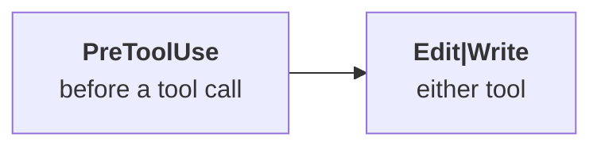

# Cheatsheet guidelines

## Frontmatter

Fields and their meanings live in [`src/types/SheetFrontmatter.ts`](https://github.com/rstacruz/cheatsheets/blob/master/src/types/SheetFrontmatter.ts), a Zod schema.

```yaml
---
title: React
subtitle: UI library
category: JavaScript libraries
tags: [Featured]
updated: 2024-01-01
---
```

- **Category:** must be one of the values in `src/config.ts` `categories`, or `Hidden` to unlist the sheet. Unknown values silently fall into `Others`; `pnpm test` enforces the list and the [size limits](#categories).
- **Subtitle:** one line shown under the title, at most 5 words. It should read naturally after the title: *Python* is a **readable language for scripting**. Sentence case, no leading article, no trailing period. Prefer a concrete noun over a vague one ("CLI argument parser", not "command line tool"). `pnpm test` enforces presence and the word limit.
- **Last verified with:** required for t1, t2, and snippet sheets, optional elsewhere (max 160 chars). Records the versions the examples target. Use `<tool> <version>.`, with several versions separated by commas. No dates or PR numbers; `updated:` already records the edit date. ISO dates like `2026-11` and PR references like `#2383` are rejected.
- **Tier:** `t1` for sheets that move often, `t2` for slower ones, `snippet` for microsheets; see [review tiers](tiers.md). Omit it for best-effort sheets.

```yaml
last_verified_with: "Conventional Commits 1.0.0, curl 8.23.0."
last_verified_with: "Ecto 3.14 / Phoenix 1.8, Elixir 1.18.6."
```


### Fragments

Every [T1 and T2 sheet](tiers.md) needs `fragments`: 12–20 short strings shown muted with
a bottom fade on the sheet's homepage card. They are decoration, not
documentation.

```yaml
fragments:
  - "curl -s"
  - "-X POST"
  - "--compressed"
  - "-H 'X-Foo: bar'"
  - "-d @file"
  - "-F file=@path"
  - "-o file"
  - "-L"
  - "-I"
  - "--http2"
  - "-O"
  - "-u user:pass"
```

- Copy commands, flags, or syntax from the sheet; never add a new command.
- Keep each fragment to 16 characters or fewer. Mid-token clipping is expected.
- The first two or three should identify the tool without the title.
- Mix shapes: commands, flags, values, syntax, codes. Avoid a run of flags.
- Quote every entry: YAML reads `-X`, `#`, `*` and `:` as syntax.
- No sentences, Markdown formatting, or trailing punctuation.
- Keep cards distinct; skip generic `--help`, `install`, `usage`.
- Order for visual rhythm, not importance.

Non-tiered sheets may omit fragments. `pnpm test` enforces presence and length.

## Categories

A category is a nav group. Its order in `src/config.ts` is the nav order; `Others` stays last.

- **Sizes:** every listed category except `Others` holds 3-16 sheets; `Others` holds at most 12. Hidden, deprecated, and archived sheets don't count.
- **New sheets:** file under the closest existing category. Don't create a category for one sheet.
- **New categories:** add one only when at least 3 sheets share it, in nav order in `src/config.ts`. The donor category must stay at 3 or more.
- **Splitting:** when a category passes 16, split it along a subject line (runtime vs library, language vs tool), not alphabetically. Both sides must stay within 3-16.
- **Merging:** when a category falls below 3, fold it into its closest parent and remove it from `src/config.ts`.
- **Others:** a last resort. If it is full, pick the closest category or split one; don't add a new "Misc".

Run `pnpm vitest run src/lib/categories.test.ts` after moving sheets.

## Content organisation

- **Progressive complexity:** Start with basics, move to advanced
- **Logical sections:** Group related functionality together
- **H2 and H3:** Organise documents into H2 and H3 sections
- **Every H2 needs at least two H3s:** one card renders as a stub; a footer that only lists links (`Also see`, `References`) is the exception.
- **No H2 preamble:** start every H2 with an H3; intro text belongs in a card.
- **Most-used first:** order H2s by how often a reader reaches for them; for an interactive tool, keyboard and everyday commands come before reference material.

H2 content length:

- Short H2s: 2-4 H3s (e.g., "Installing", "Getting started")
- Medium H2s: 4-7 H3s (e.g., "Components", "Lifecycle")  
- Long H2s: 7+ H3s (use column layouts)

Prefer splitting an H2 that outgrows 7 H3s into several H2s over growing one
section.

H3 content length:

- Focused: One main concept + examples
- Consistent: Similar depth within each H2
- Self-contained: Each H3 should be understandable independently

## Format

- Documentation is in the format of Markdown with attribute comments (see [Markdown dialect](/_docs/markdown-dialect) for the syntax)
- H3's can have the following class names:
  - `<!-- {: .-prime} -->` - Visually highlighted section. Only use once per document at most.
  - `<!-- {: .-snippet} -->` - Snippet card; pair with `.-snippets` on its H2. See [review tiers](tiers.md#snippet-sheets).
- PRE elements can have:
  - `<!-- {: .-setup} -->` - Visually muted section. Used for sections with less importance. Deprecated, use sparingly.
- H2's can have:
  - `<!-- {: .-three-column} -->` - prefer for H2s with 3+ short H3 cards; wrap code rather than fall back to two columns.
  - `<!-- {: .-two-column} -->` - the default (don't add this since it's the default)

## Cross-linking sheets

Sheets can link to related sheets with `.-crosslink`, which renders as a large
block with an arrow:

````md
[JavaScript Strings cheatsheet](./js-string)
<!-- {: .-crosslink} -->
````

- Put the link on its own paragraph, with the attribute comment on the next line.
- Link text: the target sheet's title plus "cheatsheet".
- Link with a page-relative path, eg `./js-string`.

A sheet can also act as an **index** for a family of sheets: [javascript.md](/javascript)
links to every core JavaScript sheet, and [phoenix.md](/phoenix) links to the
`phoenix-*` sheets. Name the index after the subject (eg `javascript.md` for the
JavaScript category) so the family has a canonical landing page.

Index sheets should stand on their own as quick references: give each section a
substantial example (at least five use cases per code block) rather than a
sparse two-line snippet. The Arrays section in [javascript.md](/javascript)
shows the shape.


## Writing guidelines

- Aim for brevity
- Prose comes last in a card: no paragraph may be followed by a code block or table. Fold the note into the block, or split the card
- Two code blocks in a card need an H4 between them, so each block has a label; a caption-led block is self-labelled, so it needs no H4
- Table descriptions: keep them short — 8 words max. Prefer parentheticals over separate sentences
- Sentence case headings, never Title Case
- Omit explanations if they are obvious. See `prose/omit-redundant`.
- Omit mechanics (stdout and JSON shapes, exit codes, internal tokens) unless the sheet is about them
- Leave out third-party trivia (eg which desktop owns a key chord); link the upstream docs instead
- Link install and upgrade instructions rather than restating them

## Quick starts

- Show the default interactive flow first (keys, TUI). CLI and automation recipes belong in later sections.
- One code block per step, with the explanation after each block.

## Content priorities

1. **Essential first**: Most commonly used 20% of functionality
2. **Progressive disclosure**: Basic → intermediate → advanced
3. **Practical examples**: Real-world use cases over theoretical
4. **Quick reference**: Dense information for experienced developers
5. **Learning path**: Logical progression for newcomers

## Deprecated sheets

- Outdated versions go to `<name>@<version series>.md` files (eg `phoenix@1.2.md`).
- Set `deprecated: true` to show a deprecation notice and unlist the sheet, exactly like `category: Hidden`.
- Set `deprecated_by: /<newer sheet>` to link the notice to the newer sheet; this alone also marks the sheet deprecated.

## Archived sheets

See [`archiving.md`](archiving.md) for when a sheet is worth archiving.

- Set `archived: <note>` for an obsolete sheet with no newer version. The note renders as Markdown in a notice.
- Archived sheets are unlisted like `category: Hidden` and appear on the [archive page](https://devhints.io/archive).
- `tags: [Archived]` is only a label; set `archived:` to unlist.

## Hidden sheets

- Set `category: Hidden` to keep a sheet off the homepage, the sitemap, the search index, and the related and top lists.
- Hidden sheets stay reachable at their URL and are listed on the [archive page](https://devhints.io/archive), so retire a sheet by hiding it rather than deleting it.
- Deprecated and archived sheets are unlisted the same way and share the archive page.
- Unlisted sheets are excluded from search and marked `noindex, follow`.
- Sheets under `tests/` are left out of the archive page.

## Syntax highlighting

Ensure syntax highlighting languages are part of [PrismJS's supported languages](https://github.com/PrismJS/prism/tree/v1.29.0/components).

## Rules

Each rule has a stable slug that reviews and the sheet skill link to.

### tables/cli-options

🤖 Check: `tables/shortcut-keys`.

CLI flags and slash commands get a plain table. `.-shortcuts` is for keypress columns only.

````md
| Flag                   | Description                      |
| ---------------------- | -------------------------------- |
| `-p, --print`          | Print the response and exit      |
| `--output-format json` | `text`, `json`, or `stream-json` |
| `--bare`               | Skip hooks, plugins, and memory  |
````

### tables/command-first

🤖 Check: `tables/command-first`.

In a table where a row has a cell made only of backticked code, put that code in the first column and its description after it. Commands, flags, values and paths all count.

Code mentioned inside a description does not count as a code column.

````md
| Command | Situation |
| --- | --- |
| `/grill-me` | Idea is fuzzy, no repo |
````

Do not put the command in a later column:

````md
| Situation | Command |
| --- | --- |
| Idea is fuzzy, no repo | `/grill-me` |
````

### tables/shortcut-keys

🤖 Check: `tables/shortcut-keys`.

Keypress columns get `.-shortcuts`. Use `.-shortcuts-right` when the key column is last.

````md
| Shortcut | Description   |
| -------- | ------------- |
| `Ctrl+C` | Interrupt     |
| `Esc`    | Close dialogs |

<!-- {: .-shortcuts} -->
````

### code/wrap-long-lines

🤖 Check: `code/wrap-long-lines`.

Code lines stay under 70 characters (42 in `.-three-column` sections). Wrap onto more lines rather than exceed the limit; add `.-wrap` when a line still overflows, and break arrow bodies as `=> (` … `)`. Wrapping is never a reason to avoid `.-three-column`.

````js
const fraction = (options) => (
  options.numerator / options.denominator
)
````

### code/mermaid-fences

🤖 Check: `code/mermaid-fences`.

Use a `mermaid` fence for diagrams. Name it with `accTitle:` and describe it with `accDescr:` inside the source; don't put a `title="..."` on the fence. Bold each node label and add a short description after `<br>`.

````md

````

### code/data-line-in-block

🤖 Check: `code/data-line-in-block`.

Every `data-line` reference must fall inside its fenced block; don't point past the last line. When only one token matters, use `data-highlight` instead.

````md
```elixir
a
b
```
<!-- {: data-line="2"} -->
````

### code/highlight-the-message

Every highlight — a `data-line` band or a `data-highlight` token — must illustrate the card's main message. Tint the flag, value, or line that carries the point; leave secondary options and edge cases to the prose.

**Good:** the card is about printing a range, so the range flag is tinted.

````md
### Print a range

```bash
bat -r 2:4 hello.py
```
<!-- {: data-highlight="-r 2:4"} -->
````

**Bad:** the card is about Git changes, but the tint lands on a context option instead of `-d`.

````md
### Show Git changes

```bash
bat -d notes.txt
bat -d --diff-context=1 notes.txt
```
<!-- {: data-highlight="--diff-context=1"} -->
````

### code/highlight-the-token

🤖 Check: `code/data-highlight-in-block`.

Give every code block whose subject is named in its H3 a highlight: if the card is "Select lists", tint the `select_by_*` methods; if it is "Print a range", tint `-r 2:4`. Highlight what changes behaviour; tint the command name only when the command itself is the lesson. One token is usually enough; a card about sibling methods can tint up to four, semicolon-separated. Skip blocks that are a whole workflow or whose subject has no named token.

````md
```python
driver.save_screenshot("page.png")
```
<!-- {: data-highlight="save_screenshot"} -->
````

**When the card teaches a command, tint the command name**

````md
### Create a key

```bash
ssh-keygen -t ed25519 -C "me@example.com"
```
<!-- {: data-highlight="ssh-keygen"} -->
````

`-t ed25519` only chooses a key type.

Use `data-line` instead when the whole line, or a range, is the lesson.

### code/highlight-limit

🤖 Check: `code/highlight-limit`.

At most four `data-highlight` tokens per block. Highlight sibling methods together when they carry the card's point; split the card or drop incidental tokens when the list grows.

````md
### Select lists

```python
select.select_by_value("volvo")
select.select_by_visible_text("Saab")
select.select_by_index(2)
```
<!-- {: data-highlight="select_by_value; select_by_visible_text; select_by_index"} -->
````

### code/vary-highlights

🤖 Check: `code/vary-highlights`.

Don't repeat the same highlight token across code blocks in a sheet. A tint that keeps landing on `sort` stops marking what makes a card different. Keep the command highlight on the card where the command is the lesson, then use flags or values on the rest.

**Good:** the "Sort lines" card tints `sort`; the field cards tint `-k2,2n` and `-k3,3`.

**Bad:** every sort card tints `sort`, so the tint says nothing about the card being read.

### code/data-highlight-in-block

🤖 Check: `code/data-highlight-in-block`.

Every `data-highlight` token must appear literally in its fenced block. The check catches typos that would otherwise render nothing.

````md
```bash
bat -r 2:4 hello.py
```
<!-- {: data-highlight="-r 2:4"} -->
````

### code/split-setup-and-use

🤖 Check: `code/split-setup-and-use`.

Build the value in one pre block and call it in another, each with its own H4 label; a long `const f = (x) => new Thing(x)` one-liner is hard to scan and does not wrap in narrow cards.

````md
#### Formatter

```js
const format = (value) => value.trim()
```

#### Output

```js
format(' hi ') // 'hi'
```
````

### cards/split-all-options

Split an oversized "All options" card into focused cards like `Style options` and `Digit options`.

### cards/no-updates-card

Do not add an `### Updates` or `### Upgrading` card for generic install or update instructions. Update mechanics belong in the project's own docs; link there instead. Keep such a card only when update behaviour is central to the tool's purpose, as it can be for package managers like npm or mise.

### cards/short-trailing-prose

🤖 Check: `cards/short-trailing-prose`.

Prose after the last block stays under 40 words; a single sentence usually suffices.

````markdown
### Errors

```js
parse('4.2') // → { ok: true, value: 4.2 }
```

Invalid input returns an error object.
````

### cards/size-limits

🤖 Check: `cards/size-limits`.

Keep a card under four tables and 50 lines; split it before adding another table.

### cards/prefer-three-column

Prefer `.-three-column` for an H2 with three or more short cards. Column width isn't a reason to stay two-column: wrap code to 42 characters, using `\` continuations where the language allows.

Skip when a card holds a wide table or wrapping breaks copy-paste (long quoted strings, JSON).

````md
## Manage
<!-- {: .-three-column} -->

### Configure

```sh
curl -fsSL https://example.com/config \
  --output config.json
```
````

### workflow/verify-output-against-runtime

Run the example, capture its real output, and paste it verbatim. Watch for NBSP and other invisible characters.

### prose/single-line

Keep each paragraph on one line; don't hard-wrap prose across lines.

### prose/explanations-after-blocks

Prefer explanations after a pre or table, not before it.

````markdown
### Setting default props

```jsx
Hello.defaultProps = {
  color: 'blue'
}
```

Default properties are used if no properties are given.

See: [defaultProps](https://reactjs.org/docs/react-component.html#defaultprops)
````

### code/filename-markers

When an example spans multiple files, use each filename as its H4, one code block per file.

````markdown
### via Data Attributes

#### index.html.erb

```html
<a
  href="#"
  data-reflex="click->CounterReflex#increment"
  data-step="1"
  data-count="<%= @count.to_i %>"
  >Increment <%= @count.to_i %></a
>
```

#### counter_reflex.rb

```ruby
class CounterReflex < StimulusReflex::Reflex
  def increment
    @count = element.dataset[:count].to_i + element.dataset[:step].to_i
  end
end
```

Trigger reflexes without writing any javascript with the `data-reflex` attribute.
````

### tables/reference-information

Use tables for quick scanning when showing reference information.

````markdown
### Primitives

| Sample                  | Type            |
| ---                     | ---             |
| `nil`                   | Nil/null        |
| `true` _/_ `false`      | Boolean         |
| ---                     | ---             |
| `23`                    | Integer         |
| `3.14`                  | Float           |
| ---                     | ---             |
| `"hello"`               | Binary string   |
| `:hello`                | Atom            |

These are the basic data types in Elixir.
````

### lists/enumeration-items

🤖 Check: `lists/enumeration-items`.

Use a list, not a table, for enumerable values — flags, file types, modes, names — when no item needs a description, default, or link. Write commands in a code block instead.

- Two or more items; one term or short phrase each, at most 8 words.
- No sentence punctuation, nested lists, or extra blocks.
- Add `<!-- {: .-enum} -->` after the list; the check flags qualifying lists that omit it.
- Link lists and lists with descriptions belong in a table, not a grid.

````md
- `rust`
- `js`
- `py`
- `go`
- `rb`
- `java`
<!-- {: .-enum} -->
````

### lists/term-tiles

Prefer `.-term-tiles` for a card whose items pair a short term with a prose description. Use it instead of a two-column table when descriptions need a sentence or inline code.

- Bold the term; the description follows it on the same source line and renders beneath it.
- Items are small bordered cards in a two-column grid with no bullets.
- An odd last item spans both columns; narrow screens collapse to one column.

````md
- **Tracer bullet** Narrow path through schema, API, UI and tests
- **Demoable** Verifiable on its own
<!-- {: .-term-tiles} -->
````

Use a two-column table for short mappings and reference values (dependencies, file paths, triage labels). Command lookups stay tables with the command first; see `tables/command-first`.

### lists/enumeration-width

🤖 Check: `lists/enumeration-width`.

Choose the class from the longest item; the check enforces the boundary.

- 13 characters or fewer: `.-enum`. There is no `.-enum-small`; `.-enum` is the short form.
- 14 characters or more: `.-enum-wide`, capped at two columns; at least one item must be that long.
- `.-enum-lines` shares the 13-character limit and swaps tiles for horizontal rules.

````md
- `article:published_time`
- `article:modified_time`
- `article:tag`
<!-- {: .-enum-wide} -->
````

### code/inline-comments

Use inline comments to explain results, equivalents, or provide context.

````markdown
### Pattern matching

```elixir
user = %{name: "Tom", age: 23}
%{name: username} = user  # → username = "Tom"
```

### Piping

```elixir
source
|> transform(:hello)     # Step 1: transform the data
|> print()               # Step 2: output the result
```

```elixir
# Same as:
print(transform(source, :hello))
```

### Type conversions

```elixir
Integer.parse("34")      # → {34, ""}
Float.parse("34.1")      # → {34.1, ""}
```
````

### frontmatter/introduction

🤖 Check: `frontmatter/introduction`.

Set `intro` frontmatter; it renders as the first card. Write one paragraph under 25 words, with links to at most four first-party sources.

````yaml
intro: |
  [Claude Code](https://code.claude.com/docs) is Anthropic's AI coding assistant for the terminal. This reference covers the most commonly used commands, flags, and settings.

links:
  - title: Claude Code documentation
    url: https://code.claude.com/docs
  - title: GitHub repository
    url: https://github.com/anthropics/claude-code
````

The card is generated; never write an `### Introduction` card by hand.

### tables/headers

🤖 Check: `tables/headers`.

Table headers are hidden by default. Add `.-headers` after the table when the column labels carry meaning.

````md
| Part | Required |
| --- | --- |
| `type` | yes |
| body | no |
<!-- {: .-headers} -->
````

### tables/separating

🤖 Check: `tables/separating`.

Separate tables of 8+ rows with H4 groups or `| --- |` rows.

#### H4 groups

````markdown
### Examples

#### Date

| Example                   | Output                 |
| ------------------------- | ---------------------- |
| `YYYY-MM-DD`              | 2014-01-01             |
| `dddd [the] Do [of] MMMM` | Friday the 16th of May |

#### Time

| Example   | Output   |
| --------- | -------- |
| `hh:mm a` | 12:30 pm |
````

#### Separator rows

````markdown
| Example | Output                           |
| ------- | -------------------------------- |
| `LT`    | 8:30 PM                          |
| `LTS`   | 8:30:25 PM                       |
| ---     | ---                              |
| `LL`    | August 2 1985                    |
| `ll`    | Aug 2 1985                       |
| ---     | ---                              |
| `LLLL`  | Thursday, August 2 1985 08:30 PM |
| `llll`  | Thu, Aug 2 1985 08:30 PM         |
````

### prose/omit-redundant

Omit redundant prose. When the code is self-explanatory, add no trailing paragraph.

````md
// Avoid:
```sh
wget --quiet
```

This command runs wget with the quiet option, which suppresses its output.

// Consider: no trailing paragraph
```sh
wget --quiet
```
````

When the example already shows the detail, skip the note.

````toml
# comment
key = "value" # trailing comment
quoted = "# not a comment"
````

### frontmatter/seo-descriptions

Write `keywords` with `intro` for SEO; `description` with `intro` also works. Without either, a description is generated from `intro`.

#### Keywords

````md
keywords: [React.Component, render(), componentDidMount(), props/state]
intro: |
  React is a JavaScript library for building web user interfaces.
````

#### Description

````md
description: One-page reference to React and its API.
intro: |
  React is a JavaScript library for building web user interfaces.
````

#### Intro only

````md
intro: |
  React is a JavaScript library for building web user interfaces.
````

### cards/h4-subheadings

Use H4s to split an H3 into labelled segments: concept variants, topics, or reference groups. Keep labels short and use 2–4 segments.

````markdown
### Parsing

#### As local time

```js
const date = new Date(2012, 11, 20, 3, 0, 0)
```

#### As UTC time

```js
const date = new Date(Date.UTC(2012, 11, 20, 3, 0, 0))
```
````

### tables/options-after-code

🤖 Check: `tables/options-after-code`.

Show the code example first, then label its reference table with an H4 such as `#### Options`.

````md
```sh
wget --quiet --output-document=out.html https://example.com
```

#### Options

| Flag                    | Description     |
| ----------------------- | --------------- |
| `--quiet`               | Suppress output |
| `-O, --output-document` | Write to a file |
````

### cards/two-h3-per-h2

🤖 Check: `cards/two-h3-per-h2`.

Every listed H2 needs at least two H3 cards; a footer that only lists links is exempt.

### cards/first-h2-first-journey

The opening H2 should be the reader's first journey through the tool: the everyday action, not the API taxonomy. Defer configuration details and internals to later sections.

### prose/paragraphs-last

🤖 Check: `prose/paragraphs-last`.

No paragraph may be followed by a code block or table in a card. Fold the note into the block or split the card.

### code/one-example-per-block

🤖 Check: `code/one-example-per-block`.

A code block holds one example. Start a new fence instead of stacking commented examples.

### frontmatter/h3-links

🤖 Check: `frontmatter/h3-links`.

End each H3 with a documentation link or a `See:` line on tiered sheets. Prefer upstream project docs, specifications, or the project repository; skip community wikis, Q&A sites, and blog posts unless the project endorses them as documentation.

If no authoritative page covers the section, use a linkless `See:` line instead of an unofficial link. Only when there is neither, add `<!-- see: none: short reason -->` at column 0.

````md
### Browser console
<!-- see: none: browser-only, no upstream docs -->
````

### prose/see-line

🤖 Check: `frontmatter/h3-links`.

`See:` must start at column 0 and begin a paragraph; `See also:` and mid-paragraph `See:` do not count. The line may be linkless. Only inline links `[text](url)` count; autolinks, bare URLs, reference-style links, images, links in code, and absolute `devhints.io` links do not, but links to other sheets do.

````md
See: [defaultProps](https://reactjs.org/docs/react-component.html#defaultprops)
See: `:help motion.txt`
````

## Checks

Sheet checks live in `src/lib/sheetValidation/`. Run them with:

```bash
pnpm vitest run src/lib/sheetValidation
```

Legacy violations are recorded under `src/lib/sheetValidation/baseline/`, so only new ones fail. Regenerate the baselines after cleaning sheets up:

```bash
UPDATE_SHEET_BASELINE=1 pnpm vitest run src/lib/sheetValidation
```

Then run `pnpm fmt:format`; oxfmt collapses short baseline arrays to one line.

Automated checks are marked with 🤖 on their rules in [Rules](#rules).


