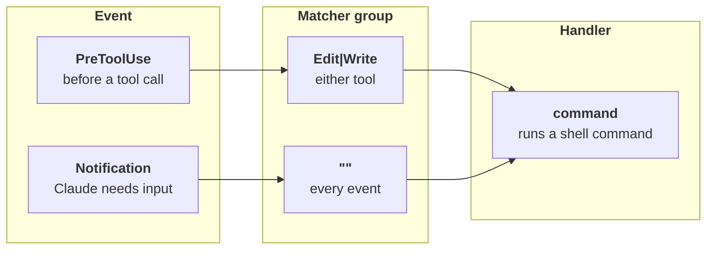

## Getting started

### Anatomy



A hook event fires at a lifecycle point. Its matcher group filters the event, then matching handlers run in parallel.

See: [Hooks reference](https://code.claude.com/docs/en/hooks)

### First hook

```json
{
  "hooks": {
    "Notification": [
      {
        "matcher": "permission_prompt",
        "hooks": [
          { "type": "command",
            "command": "notify-send 'Claude Code' 'Needs input'" }
        ]
      }
    ]
  }
}
```
<!-- {: data-highlight='"Notification"'} -->

Run `/hooks` to confirm the hook loaded. On macOS, use `osascript` instead of `notify-send`.

See: [Set up your first hook](https://code.claude.com/docs/en/hooks-guide#set-up-your-first-hook)

## Everyday hooks

### Format after edits

```json
{
  "hooks": {
    "PostToolUse": [
      {
        "matcher": "Edit|Write",
        "hooks": [
          {
            "type": "command",
            "command":
              "\"$CLAUDE_PROJECT_DIR\"/.claude/hooks/format.sh"
          }
        ]
      }
    ]
  }
}
```
<!-- {: data-highlight='"PostToolUse"'} -->

The script reads `.tool_input.file_path` with `jq`, then formats that file. Make it executable with `chmod +x`.

See: [Auto-format code after edits](https://code.claude.com/docs/en/hooks-guide#auto-format-code-after-edits)

### Block protected files

#### settings.json

```json
{
  "hooks": {
    "PreToolUse": [
      {
        "matcher": "Edit|Write",
        "hooks": [
          {
            "type": "command",
            "command":
              "\"$CLAUDE_PROJECT_DIR\"/.claude/hooks/protect-files.sh"
          }
        ]
      }
    ]
  }
}
```

#### protect-files.sh

```bash
#!/bin/bash
f=$(jq -r '.tool_input.file_path // empty')
case "$f" in
  *.env|*/package-lock.json|*/.git/*)
    echo "Protected file: $f" >&2; exit 2 ;;
esac
exit 0
```
<!-- {: data-highlight="exit 2"} -->

Exit 2 blocks the edit and shows stderr to Claude. Use the permission system for hard allow and deny rules.

See: [Block edits to protected files](https://code.claude.com/docs/en/hooks-guide#block-edits-to-protected-files)

### Notify when needed

```json
{
  "hooks": {
    "Notification": [
      {
        "matcher": "permission_prompt|idle_prompt",
        "hooks": [
          { "type": "command",
            "command": "notify-send 'Claude Code' 'Needs input'" }
        ]
      }
    ]
  }
}
```
<!-- {: data-highlight="permission_prompt|idle_prompt"} -->

`permission_prompt` waits about six seconds; `idle_prompt` about 60 seconds.

See: [Get notified when Claude needs input](https://code.claude.com/docs/en/hooks-guide#get-notified-when-claude-needs-input)

### Add context

#### settings.json

```json
{
  "hooks": {
    "SessionStart": [
      {
        "matcher": "",
        "hooks": [
          {
            "type": "command",
            "command":
              "\"$CLAUDE_PROJECT_DIR\"/.claude/hooks/context.sh"
          }
        ]
      }
    ]
  }
}
```

#### context.sh

```bash
#!/bin/bash
echo '{"hookSpecificOutput":{
  "hookEventName":"SessionStart",
  "additionalContext":"Run pnpm test before committing"
}}'
```
<!-- {: data-highlight="additionalContext"} -->

Injected context stays under 10,000 characters per field.

See: [Add context for Claude](https://code.claude.com/docs/en/hooks#add-context-for-claude)

### Run in background

```json
{
  "type": "command",
  "command": "\"$CLAUDE_PROJECT_DIR\"/.claude/hooks/run-tests.sh",
  "async": true,
  "asyncRewake": true
}
```
<!-- {: data-highlight='"async"'} -->

Async hooks don't block the turn or set decisions; `asyncRewake` wakes Claude on exit 2 and shows stderr (or stdout if empty) as a system reminder.

See: [Run hooks in the background](https://code.claude.com/docs/en/hooks#run-hooks-in-the-background)

## Events

### Session

| Event | Fires when |
| --- | --- |
| `SessionStart` | Session begins or resumes |
| `Setup` | Init-only or maintenance run |
| `PreCompact` | Before context compaction |
| `PostCompact` | After compaction |
| --- | --- |
| `ConfigChange` | A settings file changes |
| `SessionEnd` | Session terminates |
| `WorktreeCreate` | A worktree is created; replaces git behavior |
| `WorktreeRemove` | A hook-created worktree is removed |
| `PreModelSwitch` | Before a requested model switch; can block |
| `PostModelSwitch` | After the session's model changes |
<!-- {: .-headers} -->

See: [Hook lifecycle](https://code.claude.com/docs/en/hooks#hook-lifecycle)

### Prompts

| Event | Fires when |
| --- | --- |
| `UserPromptSubmit` | Prompt submitted, before processing |
| `UserPromptExpansion` | A command expands into a prompt |
| `Stop` | Claude finishes responding |
| `StopFailure` | Turn ends on an API error |
| `Notification` | A notification is sent |
| `PreSkillShellCommand` | Skill shell command; v2.1.332+ |
| `MessageDisplay` | While assistant text is displayed |
<!-- {: .-headers} -->

See: [Hook events](https://code.claude.com/docs/en/hooks#hook-events)

### Tools

| Event | Fires when |
| --- | --- |
| `PreToolUse` | Before a tool call; can block |
| `PermissionRequest` | A tool needs a decision |
| `PermissionDenied` | Auto mode denies; `retry: true` tells the model it may retry |
| `PostToolUse` | Tool call succeeds |
| --- | --- |
| `PostToolUseFailure` | Tool call fails |
| `PostToolBatch` | A parallel batch resolves |
| `TaskCreated` | `TaskCreate` creates a task; can cancel |
| `TaskCompleted` | A task is marked complete; can keep it open |
| `Elicitation` | MCP server requests user input |
| `ElicitationResult` | User answers an MCP elicitation |
<!-- {: .-headers} -->

See: [Hook events](https://code.claude.com/docs/en/hooks#hook-events)

### Files and agents

| Event | Fires when |
| --- | --- |
| `FileChanged` | A watched file changes |
| `CwdChanged` | The working directory changes |
| `DirectoryAdded` | `/add-dir` adds a directory |
| `InstructionsLoaded` | CLAUDE.md is loaded |
| `SubagentStart` | A subagent is spawned |
| `SubagentStop` | A subagent finishes |
| `TeammateIdle` | An agent team teammate goes idle |
<!-- {: .-headers} -->

See: [Hook events](https://code.claude.com/docs/en/hooks#hook-events)

## Configuration

### Locations

| File | Scope |
| --- | --- |
| `~/.claude/settings.json` | All your projects |
| `.claude/settings.json` | One project, shareable |
| `.claude/settings.local.json` | One project, personal |
| Managed policy settings | Organization-wide |
| Plugin `hooks/hooks.json` | While plugin is enabled |
| Skill frontmatter | After invocation, until `/clear` or `/resume` |
| Subagent frontmatter | While that subagent runs |
<!-- {: .-headers} -->

Hook entries merge across scopes instead of replacing each other.

See: [Hook locations](https://code.claude.com/docs/en/hooks#hook-locations)

### Matchers

| Value | Meaning |
| --- | --- |
| `*`, `""`, or omitted | Every occurrence |
| `Bash` | Exact tool name |
| `Edit\|Write` | Either tool |
| `^Notebook` | Regex: name starts with |
| `mcp__memory__.*` | Regex: server tools |
<!-- {: .-headers} -->

Regex is unanchored and applies when the value contains characters outside letters, digits, `_`, `-`, spaces, `,`, and `|`. `FileChanged` and `StopFailure` use letters, digits, `_`, and `|` only.

See: [Matcher patterns](https://code.claude.com/docs/en/hooks#matcher-patterns)

### Handler types

| Type | Runs |
| --- | --- |
| `command` | Shell command; JSON on stdin |
| `http` | POST event JSON to a URL |
| `mcp_tool` | Call a configured MCP tool |
| `prompt` | Single-turn model decision |
| `agent` | Subagent with Read, Grep, Glob |
<!-- {: .-headers} -->

Prompt and agent hooks are capped at 12 concurrent runs.

See: [Hook handler fields](https://code.claude.com/docs/en/hooks#hook-handler-fields)

### Per-type keys

| Type | Additional fields |
| --- | --- |
| `command` | `command`, `args`, `shell`, `async`, `asyncRewake`, `onFailure` |
| `http` | `url`, `headers`, `allowedEnvVars`, `onFailure` |
| `mcp_tool` | `server`, `tool`, `input`, `onFailure` |
| `prompt`, `agent` | `prompt`, `model` |
<!-- {: .-headers} -->

All types accept `type`, `if`, `timeout`, `statusMessage`; `once` applies only to skill hooks.

See: [Hook handler fields](https://code.claude.com/docs/en/hooks#hook-handler-fields)

### Fields

```json
{
  "matcher": "Bash",
  "hooks": [
    {
      "type": "command",
      "if": "Bash(git *)",
      "command": "\"$CLAUDE_PROJECT_DIR\"/.claude/hooks/git-check.sh",
      "timeout": 30,
      "statusMessage": "Checking git command"
    }
  ]
}
```
<!-- {: data-highlight="Bash(git *)"} -->

`if` holds one rule and filters six events (five before v2.1.332); on other events the hook never runs. Defaults: 600s for commands, HTTP, and MCP; 30s for prompts; 60s for agents.

See: [Common fields](https://code.claude.com/docs/en/hooks#common-fields)

### Disable

| Command | Effect |
| --- | --- |
| `/hooks` | Browse loaded hooks |
| `claude --settings '{"disableAllHooks": true}'` | Disable for one run |
| `claude -p --bare "review this"` | Skip hooks and plugins |
<!-- {: .-headers} -->

`disableAllHooks` temporarily disables unmanaged hooks; managed hooks need managed settings. `--settings` overrides project settings for one run. Delete a hook's entry to remove it.

See: [Disable or remove hooks](https://code.claude.com/docs/en/hooks#disable-or-remove-hooks)

## Decisions

### Exit codes

| Code | Result |
| --- | --- |
| `0` | Success; apply JSON on stdout |
| `2` | Block when supported; stderr explains |
| other | Non-blocking error |
<!-- {: .-headers} -->

`onFailure: "block"` also blocks on hook failure. On events that cannot block, exit 2 is ignored or only surfaces stderr; see [exit code behavior per event](https://code.claude.com/docs/en/hooks#exit-code-2-behavior-per-event).

See: [Exit code output](https://code.claude.com/docs/en/hooks#exit-code-output)

### JSON output

```json
{
  "hookSpecificOutput": {
    "hookEventName": "PreToolUse",
    "permissionDecision": "deny",
    "permissionDecisionReason": "Destructive command"
  }
}
```
<!-- {: data-highlight="hookSpecificOutput"} -->

Exit 0 and print only JSON for finer control than exit codes.

See: [JSON output](https://code.claude.com/docs/en/hooks#json-output)

### Output fields

| Field | Effect |
| --- | --- |
| `decision: "block"` | Block the action; `reason` explains |
| `continue: false` | Stop Claude entirely; `stopReason` explains |
| `permissionDecision` | Allow, deny, ask, or defer a tool call |
| `systemMessage` | Warn the user |
| `terminalSequence` | Emit an allowlisted terminal sequence |
<!-- {: .-headers} -->

`permissionDecision` and `additionalContext` live in `hookSpecificOutput` with `hookEventName`.

See: [Decision control](https://code.claude.com/docs/en/hooks#decision-control)

## Also see

<!-- {: .-one-column} -->

- [Claude Code cheatsheet](./claude-code) _(devhints.io)_
- [Claude Code commands](./claude-code-commands) _(devhints.io)_
- [Agent skills](./skills) _(devhints.io)_
- [Hooks reference](https://code.claude.com/docs/en/hooks) _(code.claude.com)_
- [Hooks guide](https://code.claude.com/docs/en/hooks-guide) _(code.claude.com)_
