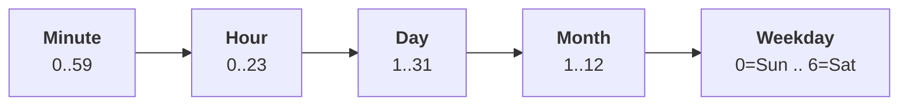

## Format

<!-- {: .-two-column} -->

### Format

```
Min  Hour Day  Mon  Weekday
```

<!-- {: .-setup} -->

```
*    *    *    *    *  command to be executed
```

#### Fields



### Operators

| Operator | Description                |
| ---      | ---                        |
| `*`      | all values                 |
| `,`      | separate individual values |
| `-`      | a range of values          |
| `/`      | divide a value into steps  |

### Special strings

| String       | Description                            |
| ---          | ---                                    |
| `@reboot`    | every rebot                            |
| `@hourly`    | once every hour - same as `0 * * * *`  |
| `@daily`     | once every day - same as `0 0 * * *`   |
| `@midnight`  | once every midnight - same as `@daily` |
| `@weekly`    | once every week - same as `0 0 * * 0`  |
| `@monthly`   | once every month - same as `0 0 1 * *` |
| `@yearly`    | once every year - same as `0 0 1 1 *`  |

### Examples

| Example        | Description                 |
| ---            | ---                         |
| `0 * * * *`    | every hour                  |
| `*/15 * * * *` | every 15 mins               |
| `0 */2 * * *`  | every 2 hours               |
| `0 18 * * 0-6` | every week Mon-Sat at 6pm   |
| `10 2 * * 6,7` | every Sat and Sun on 2:10am |
| `0 0 * * 0`    | every Sunday midnight       |

### Crontab

```bash
# Adding tasks easily
echo "@reboot echo hi" | crontab
```

```bash
# Open in editor - optional for another user
crontab -e [-u user]
```

```bash
# List tasks - optional for another user
crontab -l [-u user]
```

```bash
# Delete crontab file - optional for another user
crontab -r [-u user]
```
