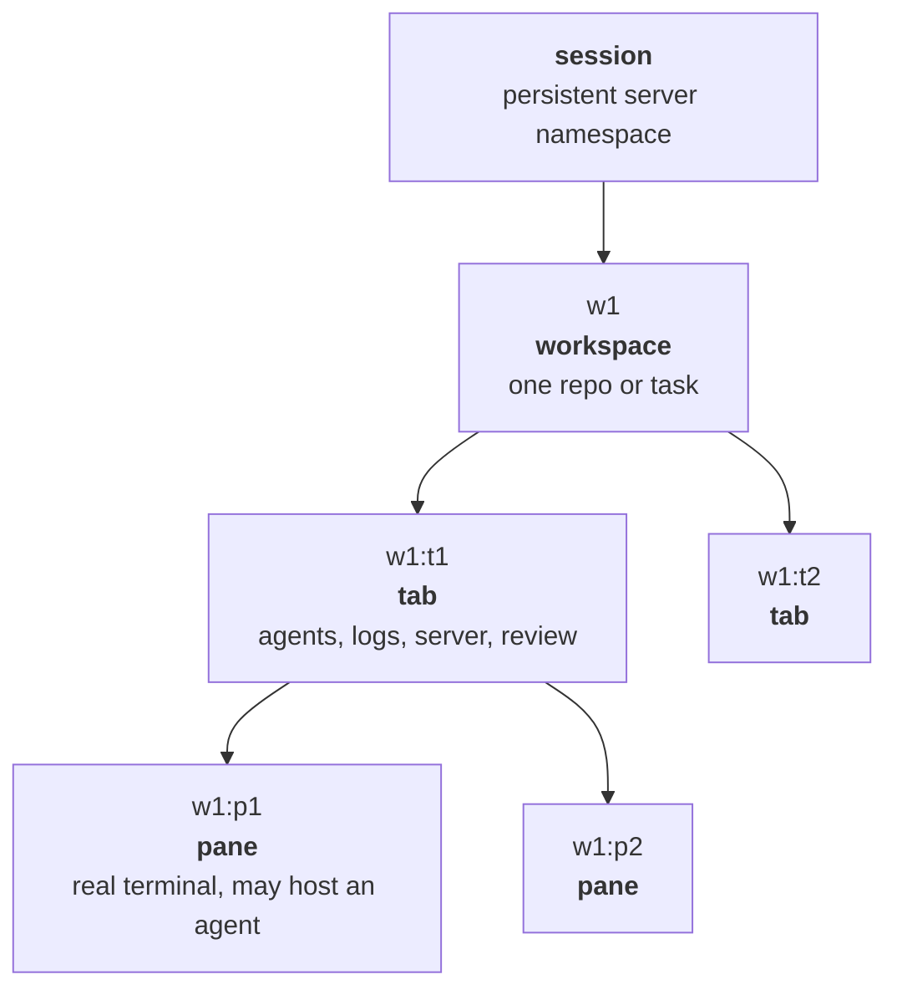

## Keyboard

### Learn these first

| Shortcut | Action |
| --- | --- |
| `prefix+c` | New tab |
| `prefix+v` / `prefix+minus` | Split right / down |
| `prefix+h/j/k/l` | Move between panes |
<!-- {: .-shortcuts} -->

The prefix is `ctrl+b` by default; `prefix+?` lists every active binding.

See: [Keyboard](https://herdr.dev/tui/docs/keyboard/)

### Everyday keys

| Shortcut | Action |
| --- | --- |
| `prefix+n` / `prefix+p` | Next / previous tab |
| `prefix+z` | Zoom focused pane |
| `prefix+x` | Close pane |
| `prefix+[` | Copy mode |
| `prefix+g` | Goto picker |
| `prefix+shift+n` | New workspace |
<!-- {: .-shortcuts} -->

The Goto picker searches agents, terminals, branches, and paths.

See: [Keyboard](https://herdr.dev/tui/docs/keyboard/)

### Workspaces and detach

| Shortcut | Action |
| --- | --- |
| `prefix+w` | Workspace navigation |
| `prefix+q` | Detach; everything keeps running |
<!-- {: .-shortcuts} -->

See: [Keyboard](https://herdr.dev/tui/docs/keyboard/)

[Herdr keys cheatsheet](./herdr-keys)
<!-- {: .-crosslink} -->

## Getting started

### Concepts

#### Layout



#### Commands

```bash
herdr session list                 # persistent server namespaces
herdr workspace list               # w1, w2, ...
herdr tab list --workspace w1      # w1:t1, w1:t2, ...
herdr pane list --workspace w1     # w1:p1, w1:p2, ...
herdr pane current --current       # the calling pane's ID
```
<!-- {: data-highlight="--workspace w1"} -->

A pane is a real terminal, preserved across detach. An agent is a process Herdr recognizes in a pane. A session is a persistent server namespace; `herdr` attaches to the default one.

See: [Concepts](https://herdr.dev/tui/docs/concepts/)

### Quick start

```bash
herdr     # launch, or reattach to a session
claude    # run an agent; Herdr detects it
```

Split with `prefix+v`, open a tab with `prefix+c`, and detach with `prefix+q`; panes and agents keep running.

See: [Quick start](https://herdr.dev/tui/docs/quick-start/)

## Command map

### Layout

#### Workspaces and tabs

| Command | Purpose |
| --- | --- |
| `herdr workspace` | Create, focus, rename, close workspaces |
| `herdr tab` | Manage tabs inside a workspace |
<!-- {: .-shortcuts} -->

#### Panes and worktrees

| Command | Purpose |
| --- | --- |
| `herdr pane` | Split, run, read, move, close panes |
| `herdr worktree` | Create, open, remove git worktrees |
<!-- {: .-shortcuts} -->

See: [CLI reference](https://herdr.dev/tui/docs/cli-reference/)

### Agents

#### Control agents

```bash
herdr agent start reviewer --kind claude --pane w1:p1
herdr agent prompt reviewer "review this diff" --wait
herdr agent wait reviewer --until blocked --timeout 120000
herdr agent read w1:p1 --lines 120
herdr agent attach reviewer
```

#### Commands

| Command | Purpose |
| --- | --- |
| `herdr agent` | Start, prompt, wait on, read agents |
| `herdr integration` | Install, check agent integrations |
| `herdr plugin` | Install, update, manage plugins |
<!-- {: .-shortcuts} -->

States are `idle`, `working`, `blocked`, `done`, and `unknown`; `idle` and `done` both mean ready for input.

See: [Agents](https://herdr.dev/tui/docs/agents/)

[Herdr agents cheatsheet](./herdr-agents)
<!-- {: .-crosslink} -->

### Sessions and server

#### Sessions and machines

| Command | Purpose |
| --- | --- |
| `herdr session` | Named sessions: list, attach, stop, delete |
| `herdr machine` | Saved SSH machines; `--machine` routes API commands |
<!-- {: .-shortcuts} -->

#### Server

| Command | Purpose |
| --- | --- |
| `herdr server` | Headless server; stop, reload config, manage agent manifests |
| `herdr status` | Show client and server state |
<!-- {: .-shortcuts} -->

See: [CLI reference](https://herdr.dev/tui/docs/cli-reference/)

### Utilities

| Command | Purpose |
| --- | --- |
| `herdr api` | Socket API snapshot and schema |
| `herdr terminal` | Attach to or observe terminal streams |
| `herdr notification` | Show a notification |
| `herdr update` | Update a direct install |
| `herdr channel` | Show or set the update channel |
| `herdr config` | Check config; reset custom keybindings |
| `herdr completion` | Generate shell completions |
<!-- {: .-shortcuts} -->

See: [CLI reference](https://herdr.dev/tui/docs/cli-reference/)

## Configuration

### Config file

```bash
herdr --default-config > ~/.config/herdr/config.toml
herdr config check
herdr server reload-config
```

Linux and macOS use `~/.config/herdr/config.toml`; Windows uses `%APPDATA%\herdr\config.toml`. `HERDR_CONFIG_PATH` overrides the path and `HERDR_SESSION` selects a named session for CLI commands.

See: [Configuration](https://herdr.dev/tui/docs/configuration/)

### Keybindings

```toml
[keys]
prefix = "ctrl+a"
new_tab = ["prefix+c", "ctrl+alt+c"]
```

Every binding is configurable, including the prefix. A binding can be a key or an array of keys; `prefix+?` lists bindings. `herdr config reset-keys` backs up `config.toml` and drops custom `[keys]` and `[[keys.command]]`; restart or `herdr server reload-config` to apply.

See: [Keybindings](https://herdr.dev/tui/docs/configuration/#keybindings)

### Mouse capture

```toml
[ui]
mouse_capture = false
```

With `mouse_capture = false`, Herdr's mouse UI is off and clicks reach the outer terminal and pane apps.

See: [Concepts](https://herdr.dev/tui/docs/concepts/)

## Also see

- [tmux](./tmux)
- [screen](./screen)
- [Claude Code](./claude-code)
- [OpenAI Codex](./codex)
<!-- {: .-also-see} -->
