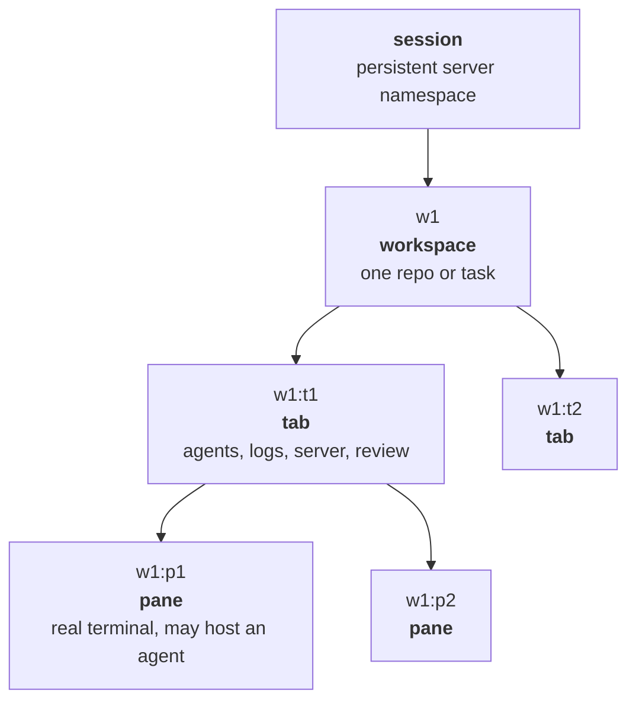

## Keyboard

### Learn these first

| Shortcut | Action |
| --- | --- |
| `prefix+c` | New tab |
| `prefix+v` / `prefix+minus` | Split right / down |
| `prefix+h/j/k/l` | Move between panes |
| `prefix+w` | Workspace navigation |
| `prefix+q` | Detach; everything keeps running |
<!-- {: .-shortcuts} -->

The prefix is `ctrl+b` by default; `prefix+?` lists every active binding.

[Herdr keys cheatsheet](./herdr-keys)
<!-- {: .-crosslink} -->

## Getting started

### Concepts

#### Layout



#### Commands

```bash
herdr session list                 # persistent server namespaces
herdr workspace list               # w1, w2, ...
herdr tab list --workspace w1      # w1:t1, w1:t2, ...
herdr pane list --workspace w1     # w1:p1, w1:p2, ...
herdr pane current --current       # the calling pane's ID
```

A pane is a real terminal, preserved across detach. An agent is a process
Herdr recognizes in a pane. A session is a persistent server namespace;
`herdr` attaches to the default one.

See: [Concepts](https://herdr.dev/tui/docs/concepts/)

### Quick start

```bash
herdr     # launch, or reattach to a session
claude    # run an agent; Herdr detects it
```

Split with `prefix+v`, open a tab with `prefix+c`, and detach with `prefix+q`; panes and agents keep running.

See: [Quick start](https://herdr.dev/tui/docs/quick-start/)

## Command map

### Layout

#### Workspaces and tabs

| Command | Purpose |
| --- | --- |
| `herdr workspace` | Create, focus, rename, close workspaces |
| `herdr tab` | Manage tabs inside a workspace |
<!-- {: .-shortcuts} -->

#### Panes and worktrees

| Command | Purpose |
| --- | --- |
| `herdr pane` | Split, run, read, move, close panes |
| `herdr worktree` | Create, open, remove git worktrees |
<!-- {: .-shortcuts} -->

See: [CLI reference](https://herdr.dev/tui/docs/cli-reference/)

### Agents

| Command | Purpose |
| --- | --- |
| `herdr agent` | Start, prompt, wait on, read agents |
| `herdr integration` | Install agent integrations |
| `herdr plugin` | Install, update, manage plugins |
<!-- {: .-shortcuts} -->

[Herdr agents cheatsheet](./herdr-agents)
<!-- {: .-crosslink} -->

### Sessions and server

#### Sessions and machines

| Command | Purpose |
| --- | --- |
| `herdr session` | Named sessions: list, attach, stop, delete |
| `herdr machine` | Saved SSH machines; `--machine` routes commands |
<!-- {: .-shortcuts} -->

#### Server

| Command | Purpose |
| --- | --- |
| `herdr server` | Headless server; stop, reload-config, manifests |
| `herdr status` | Show client and server state |
<!-- {: .-shortcuts} -->

See: [CLI reference](https://herdr.dev/tui/docs/cli-reference/)

### Utilities

| Command | Purpose |
| --- | --- |
| `herdr api` | Socket API snapshot and schema |
| `herdr terminal` | Attach to raw terminal streams |
| `herdr notification` | Show a notification |
| `herdr update` | Update a direct install |
| `herdr channel` | Show or set the update channel |
| `herdr config` | Validate config or reset keybindings |
| `herdr completion` | Generate shell completions |
<!-- {: .-shortcuts} -->

See: [CLI reference](https://herdr.dev/tui/docs/cli-reference/)

## Also see

- [tmux](./tmux)
- [screen](./screen)
- [Claude Code](./claude-code)
- [Codex](./codex)
<!-- {: .-also-see} -->
