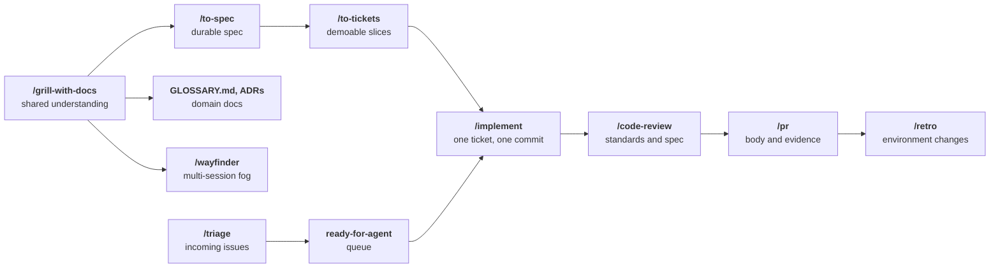

## Getting started

### First run

```text
/setup-matt-pocock-skills
```
<!-- {: data-highlight="/setup-matt-pocock-skills"} -->

Once per repo, before other engineering skills. It explores the repo, confirms answers one section at a time, and writes repo-local markdown. Only the human can invoke it.

See: [Setup skill](https://www.aihero.dev/skills-setup-matt-pocock-skills)

### What setup writes

| File | Contents |
| --- | --- |
| `docs/agents/issue-tracker.md` | GitHub, GitLab, local markdown, or described workflow |
| `docs/agents/domain.md` | Single- or multi-context doc layout |
| `docs/agents/triage-labels.md` | Label mapping, only with `triage` installed |
| `CLAUDE.md` or `AGENTS.md` | `## Agent skills` block pointing at those files |

See: [Setup SKILL.md](https://github.com/mattpocock/skills/blob/v1.3.2/skills/engineering/setup-matt-pocock-skills/SKILL.md)

### Blur to decided

```text
/grill-with-docs add SSO for the admin console
```
<!-- {: data-highlight="/grill-with-docs"} -->

The result is shared understanding you hand to `/to-spec`; the next sheet covers how the interview runs.

See: [grill-with-docs](https://www.aihero.dev/skills-grill-with-docs)

[Grill me cheatsheet](./grill-me)
<!-- {: .-crosslink} -->

### Decided to tickets

```text
/to-spec add SSO for the admin console
/to-tickets #42
```
<!-- {: data-highlight="/to-spec; /to-tickets"} -->

/to-spec synthesises the conversation without a new interview; `/to-tickets` slices the spec into demoable work with blocking edges.

See: [to-spec](https://www.aihero.dev/skills-to-spec)

### Tickets to PR

```text
/implement #43
/code-review main
/pr
```
<!-- {: data-highlight="/implement; /code-review; /pr"} -->

One ticket per fresh context. `/implement` drives red-green tests at the agreed seams, calls review and commits; `/pr` shapes the body.

See: [pr](https://www.aihero.dev/skills-pr)

## The pipeline

### Flow



See: [Flow map](https://www.aihero.dev/skills-ask-matt)

### Gates

| Command | End state |
| --- | --- |
| `/grill-with-docs` | frontier empty, user confirms shared understanding |
| `/to-spec` | seam check confirmed, spec published `ready-for-agent` |
| `/to-tickets` | numbered breakdown approved, demoable slices with blocking edges |
| `/implement` | typecheck, single tests, full suite once, review, commit |
| `/code-review` | resolvable point, non-empty diff, Standards and Spec reports |
| `/pr` | body: Summary, before/after Evidence, door, blast radius |

See: [Flow map](https://www.aihero.dev/skills-ask-matt)

### Which command

#### Find the skill

| Command | Situation |
| --- | --- |
| `/ask-matt` | Unsure which skill fits |
| `/grill-me` | Idea is fuzzy, no repo |
| `/grill-with-docs` | Fuzzy, in a repo |
| `/wayfinder` | Fog spans sessions |
| `/to-spec` | Decided, need a durable spec |
<!-- {: .-headers} -->

#### Build the work

| Command | Situation |
| --- | --- |
| `/to-tickets` | Spec ready to slice |
| `/implement` | Decided, ready to code |
| `/implement-spec` | Whole spec, many tickets |
<!-- {: .-headers} -->

See: [Router](https://www.aihero.dev/skills-ask-matt)

### Around the flow

| Command | Role |
| --- | --- |
| `/triage` | Moves incoming issues through state roles to `ready-for-agent` |
| `/handoff` | Portable summary in the OS temp dir |
| `/retro` | Suggests environment changes after a session |

See: [Triage](https://www.aihero.dev/skills-triage)

### Invocation

- **Human only** `/grill-me`, `/grill-with-docs`, `/to-spec`, `/implement`, `/triage`, `/setup-matt-pocock-skills`
- **Model or human, via Skill tool** `grilling`, `tdd`, `code-review`, `pr`
- **Never** A Skill tool call to a user-invoked skill
<!-- {: .-term-tiles} -->

See: [Invocation rules](https://github.com/mattpocock/skills/blob/v1.3.2/.agents/invocation.md)

## Planning

### Spec

- **Problem Statement** The problem from the user's perspective
- **Solution** The solution from the user's perspective
- **User Stories** Numbered "As an actor, I want..." stories
- **Implementation Decisions** Modules, interfaces, constraints, no file paths
- **Testing Decisions** Good-test rule, modules, prior art
- **Out of Scope** Refused work
- **Further Notes** Anything left over
<!-- {: .-term-tiles} -->

See: [to-spec](https://www.aihero.dev/skills-to-spec)

### Tickets

- **Tracer bullet** Narrow path through schema, API, UI and tests
- **Demoable** Verifiable on its own
- **Single context** Sized for one fresh context window
- **Blocking edges** Prerequisites; work the frontier first
- **Wide refactor** Expand, migrate in batches, then contract
<!-- {: .-term-tiles} -->

See: [to-tickets](https://www.aihero.dev/skills-to-tickets)

### Domain docs

#### Glossary

```md
**Invoice**:
A request for payment sent to a customer after delivery.
_Avoid_: Bill, payment request
```
<!-- {: data-highlight="**Invoice**; _Avoid_"} -->

#### ADRs

```md
# Write model

Orders go to Postgres; the read model is projected into Redis.
```

Terms go into `GLOSSARY.md` inline. An ADR needs all three gates: hard to reverse, surprising, a real trade-off.

See: [domain-modeling](https://www.aihero.dev/skills-domain-modeling)

### Tracker

| Tracker | Ticket store |
| --- | --- |
| GitHub | Issues via `gh` |
| GitLab | Issues via `glab` |
| Local markdown | Files under `.scratch/<feature>/issues/NN-slug.md` |
| Other | Freeform workflow described in prose |

See: [Local tracker template](https://github.com/mattpocock/skills/blob/v1.3.2/skills/engineering/setup-matt-pocock-skills/issue-tracker-local.md)

## Building

### Implement

| Command | Use |
| --- | --- |
| `/implement #43` | One ticket, one commit on the current branch |
| `/implement-spec` | Whole spec on an integration branch |
<!-- {: .-headers} -->

See: [implement](https://www.aihero.dev/skills-implement)

### TDD loop

```text
red   -> failing test at an agreed seam
green -> minimum code to pass
```
<!-- {: data-highlight="red; green"} -->

#### Pitfalls

- **One slice at a time** Repeat red-green; refactoring belongs in review
- **Implementation-coupled** Breaks on refactor, not behaviour
- **Tautological** Assertion recomputes the expected value
<!-- {: .-term-tiles} -->

See: [tdd](https://www.aihero.dev/skills-tdd)

### Review and PR

```md
## Summary
<diagram, diff-sketch, or tree>
## Evidence
**Before:** <screenshot or failing run>
**After:** <screenshot or passing run>
## Merge Danger
**Door:** two-way
**Blast Radius:** docs only
```
<!-- {: data-highlight="## Summary; ## Evidence"} -->

See: [code-review](https://www.aihero.dev/skills-code-review)
